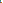
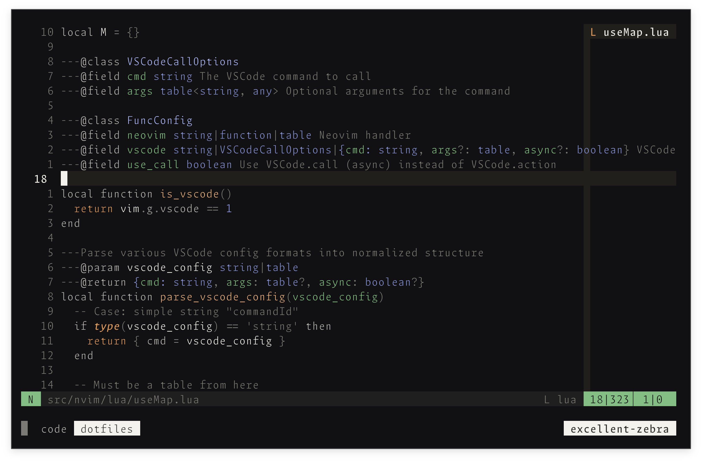
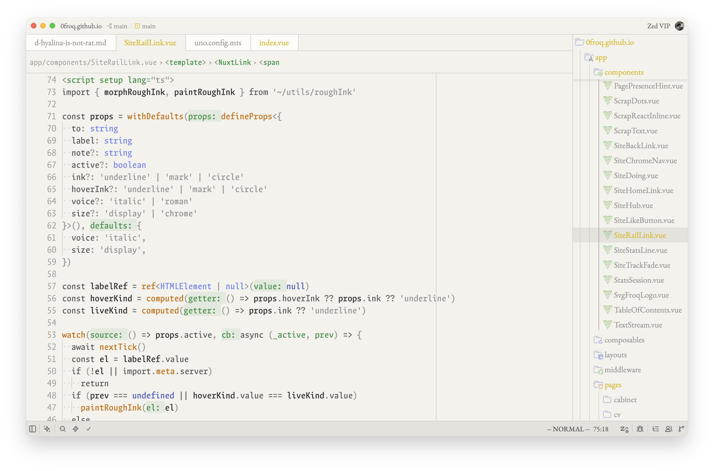
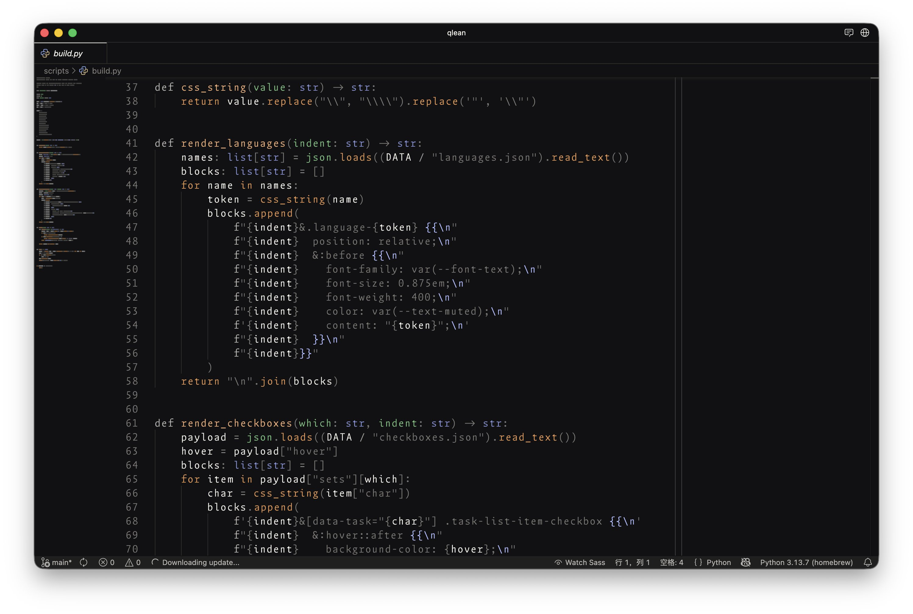
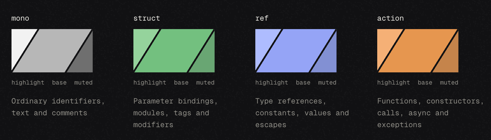

#  LiG

<p align="center">
  
  <a href="https://github.com/0froq/lig.nvim"></a>
  <a href="https://github.com/0froq/vscode-theme-LiG"></a>
  <a href="https://github.com/0froq/zed-theme-LiG"></a>
  <a href="https://github.com/0froq/lig/stargazers"></a>
  <a href="LICENSE"></a>
</p>

Less is Great.
A **theme family** so syntax colors stay put when you switch tools.

If you highlight everything, you highlighted nothing.
So with great restraint,
LiG uses only green, blue, orange, and a neutral scale.

> [!NOTE]
> Still settling after a refactor. Some rough spots remain.

## Preview

<details>
<summary>Editor previews (caution: protect your eyes)</summary>







</details>

## Color

Each role has a job:



Four variants:
`light`, `dark`, `light-paper`, `dark-paper`.
The only authored source is [`core/spec.json`](core/spec.json).
All ports are based on it.
Anyway, they share the idea instead of being exactly the same,
due to differences in editors.
Neovim uses Tree-sitter,
VS Code uses TextMate,
and the grammars do not classify the same way.

> [!IMPORTANT]
> LiG is a color theme.
> Critique the taste if you want.
> Don't open issues to steer it toward another design.
> Notes on color, readability, emphasis, and editor UI are welcome.

## Install

Install an editor port from its own repository.

| Port | Where |
| --- | --- |
| Neovim | [lig.nvim](https://github.com/0froq/lig.nvim) |
| VS Code | [vscode-theme-LiG](https://github.com/0froq/vscode-theme-LiG) |
| Zed | [zed-theme-LiG](https://github.com/0froq/zed-theme-LiG) |
| Ghostty, fzf, Zellij, tmux, Starship, bat, eza | [lightweight ports](ports/lightweight/README.md) |

Editor stores can lag behind GitHub.
Follow the install notes in each distribution.

## Develop

```bash
pnpm install --frozen-lockfile
pnpm dev
pnpm tokens:generate
pnpm tokens:check
pnpm ports:generate
pnpm ports:check
```

Change colors in `core/spec.json`, then regenerate.
Do not edit `core/generated/` or `palette/generated/` by hand
unless you know what you're doing.
`tokens:check` and `ports:check` fail when generated files drift from the spec.
The color contract is in [`core/README.md`](core/README.md).
The port compiler is in [`ports/README.md`](ports/README.md).

## Contributing

Open an issue for a color, readability, emphasis, or editor-UI problem,
and include the variant and the port.

For a code change:

1. Edit the source here.
   Distribution repositories are generated output.
   A fix in `lig.nvim`, `vscode-theme-LiG`, or `zed-theme-LiG` will be overwritten.
2. Keep one change to one concern.
3. Run the check that covers what you touched: `pnpm tokens:check` for colors, `pnpm ports:check` for ports.

Issues that ask LiG to become a different theme will be closed.

## Contact

Email: [sayhola@froq.me](mailto:sayhola@froq.me)
GitHub: [@0froq](https://github.com/0froq)

## Acknowledgements

- [OKLab and OKLCH](https://bottosson.github.io/posts/oklab/) by Björn Ottosson. Palette coordinates are written in OKLCH and mixed in OKLab.
- [Vitesse Theme](https://github.com/antfu/vscode-theme-vitesse) by Anthony Fu, itself based on Primer. The VS Code workbench bindings come from there.
- [nvim-treesitter](https://github.com/nvim-treesitter/nvim-treesitter) for the highlight queries used by the syntax demo.
- [Geist](https://vercel.com/font) by Vercel, and [Instrument Serif](https://fonts.google.com/specimen/Instrument+Serif), for the site. Both are SIL OFL 1.1.
- [Allura](https://github.com/googlefonts/allura) and EMS Allure for the handwriting strokes. Sheldon B. Michaels made EMS Allure, Windell H. Oskay converted it to SVG, and Rob Leuschke designed Allura. SIL OFL 1.1.

The site is built with Nuxt and Vue.

## Star History

[](https://www.star-history.com/?repos=0froq%2Flig&type=date&legend=bottom-right)

## License

LiG's own code is released under the [MIT License](LICENSE).

These parts keep their own licenses:

- Handwriting strokes in [`vendor/ui/src/core/signature/`](vendor/ui/src/core/signature/) are SIL OFL 1.1. Copyright 2010 The Allura Project Authors. The notice is in `NOTICE.md` and `OFL.txt`.
- Highlight queries in [`syntax/queries/`](syntax/queries/) are unmodified nvim-treesitter snapshots: Apache-2.0, and MIT for the Python query (Copyright 2016 Max Brunsfeld).
- Generated Neovim, Zed, VS Code, and lightweight ports use this same MIT license. The VS Code package also keeps the Primer (2020) and Anthony Fu (2021) notice in [`ports/licenses/MIT-vscode.txt`](ports/licenses/MIT-vscode.txt). Earlier lig.nvim releases stay Apache-2.0 until they are published again.
- Geist and Instrument Serif are SIL OFL 1.1 dependencies. They are not part of this MIT grant.
